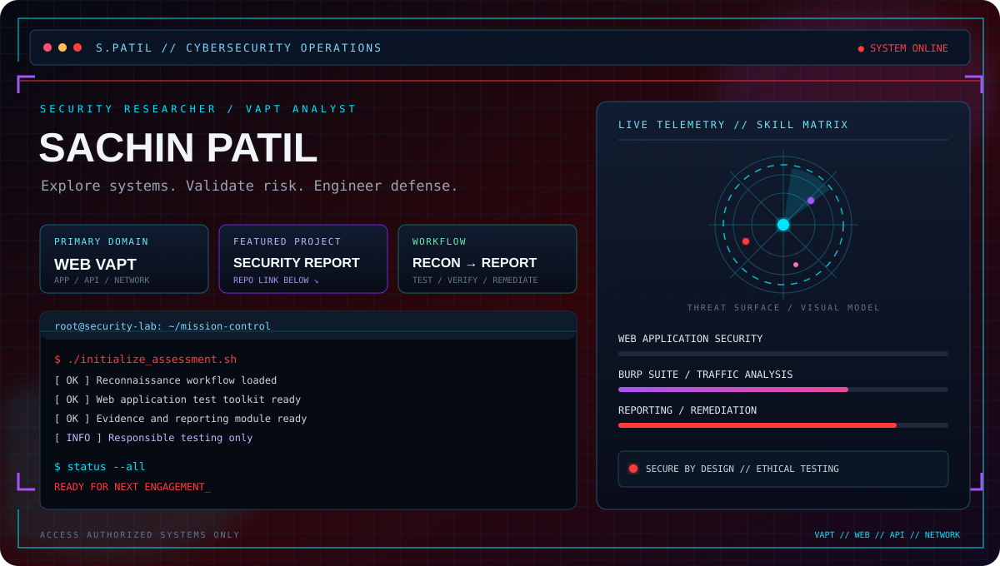

  

01 / OPERATOR PROFILE
<table> <tr> <td width="60%" valign="top">
Sachin Patil
Cyber Security Associate (VAPT)

Specializing in Web Application, API, and Network Vulnerability Assessment and Penetration Testing (VAPT), with experience across 45+ authorized security engagements and 10+ client environments.

Reconnaissance, manual and automated vulnerability assessment
Exploitation validation, PoC development, and CVSS-based risk scoring
Client-ready technical reporting and remediation retesting
OWASP Top 10 and OWASP Testing Guide methodologies
</td> <td width="40%" valign="top">
SYSTEM STATUS
Module	State
Authorized engagements	45+
Client environments	10+
C3SA certification	CERTIFIED
CEH	IN PROGRESS
</td> </tr> </table>
02 / FEATURED MISSION
<table> <tr> <td width="35%" align="center" valign="middle"> 

    </td> <td valign="top">
Web Application Penetration Test — Portfolio & Admin Panel (PHP/MySQL)
A documented security assessment of my own live PHP/MySQL portfolio website and admin panel (sachincybersecurity.site.je).

Assessment results

Identified and documented 9 vulnerabilities: 2 Critical, 1 High, 4 Medium, and 2 Low
Validated findings with PoC evidence and business-impact analysis
Documented remediation guidance and retested fixes
Published the report with an executive summary, findings, evidence, and recommendations
Repository: my-website-security-report

</td> </tr> </table>
OTHER SECURITY LABS
Web Application Penetration Testing
Manual testing of my own live PHP/MySQL portfolio and admin panel using Burp Suite, Kali Linux, shcheck, and browser DevTools, following OWASP Top 10 and OWASP Testing Guide methodology. Findings included SQL injection authentication bypass, reflected XSS, missing rate limiting, missing MFA, insecure session-cookie flags, and verbose error/stack-trace disclosure. The report documents PoC evidence, severity, business impact, and remediation guidance.

02.1 / SOC OPERATIONS
SOC Trainee — EyeQ Technologies, Thane · August 2025 – February 2026

Investigated phishing, malware, and suspicious-activity alerts and escalated confirmed threats according to SOC procedures.
Enriched Indicators of Compromise (IOCs) using VirusTotal and AbuseIPDB to support investigation and triage.
Documented incident findings through ticketing and escalation workflows.
03 / TECHNICAL ARSENAL
<table> <tr> <td width="50%" valign="top">
// TESTING & ANALYSIS
     </td> <td width="50%" valign="top">
// TOOLKIT
      </td> </tr> <tr> <td valign="top">
// NETWORK
TCP/IP · DNS · DHCP · HTTP/S · SSL/TLS · OSI Model · Network & Service Enumeration

</td> <td valign="top">
// WEB & API
SQL Injection · XSS · IDOR · Authentication & Authorization · Session Management · File Upload Security · Input Validation

</td> </tr> </table>
04 / CERTIFICATION DATABASE
<table> <tr> <td align="center" width="33%"> 
Certified Cyber Security Analyst (C3SA)

</td> <td align="center" width="33%"> 
Sophos Central Endpoint Protection Engineer

</td> <td align="center" width="33%"> 
Certified Ethical Hacker (CEH) — In Progress

</td> </tr> </table>
05 / ACTIVITY MONITOR

     

06 / ESTABLISH CONNECTION

 

EXPLORE / ASSESS / VALIDATE / SECURE

AUTHORIZED TESTING ONLY · END OF TRANSMISSION

⋮⋮⋮⋮
⋮⋮⋮⋮
